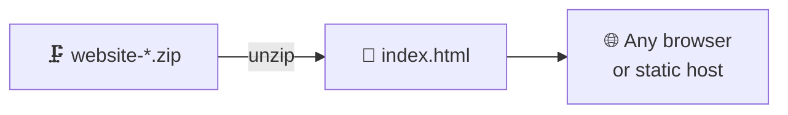

<p align="center">
  
</p>

<p align="center">
  
  
  
  
</p>
<p align="center">
  
</p>

<h3 align="center">An archived single-page website build for a cleaning-services business.</h3>

<p align="center"></p>

## 📦 What's here

This repository holds one zipped export, `website-00153cf9-6945-492c-9574-43fbefee53ee.zip`, which contains a single self-contained `index.html` (about 27 KB).



## 🛠️ Open it

```bash
unzip website-*.zip -d site
start site/index.html        # Windows
open site/index.html         # macOS
```

## 🧭 Related work

| Repo | Role |
|---|---|
| [`spick-and-span-lead-intake`](https://github.com/F0rger123/spick-and-span-lead-intake) | Cloudflare Worker behind the live estimate form |
| [`cleaning-crm-saas`](https://github.com/F0rger123/cleaning-crm-saas) | The multi-tenant CRM that replaces both |
| [`SimplyClean-CRM`](https://github.com/F0rger123/SimplyClean-CRM) | Earlier front-end CRM prototype |

## 📜 License

Released under the [MIT License](LICENSE). Use it, fork it, ship it.

<p align="center"></p>

<p align="center">
  <sub>Built by <a href="https://github.com/F0rger123"><b>@F0rger123</b></a> · MIT licensed</sub>
</p>
